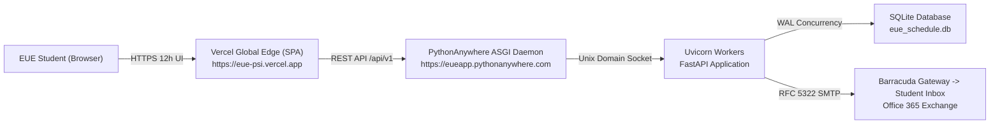

# 🎓 EUE — Student Schedule & Social Sync

[](https://eue-psi.vercel.app)
[](https://eueapp.pythonanywhere.com/docs)
[](https://fastapi.tiangolo.com)
[](https://reactnative.dev)
[](https://eue-psi.vercel.app)

An intelligent, full-stack scheduling and campus social synchronization platform engineered specifically for students across the **European Universities in Egypt (EUE)** partner universities (**University of London**, **University of Central Lancashire (UCLan)**, and **University of East London (UEL)**).

---

## 🌐 Live Production Links

- **Web Application (SPA)**: [https://eue-psi.vercel.app](https://eue-psi.vercel.app)
- **Interactive Swagger API Docs**: [https://eueapp.pythonanywhere.com/docs](https://eueapp.pythonanywhere.com/docs)
- **Backend Health Check**: [https://eueapp.pythonanywhere.com/](https://eueapp.pythonanywhere.com/)

---

## ✨ Key Features

### 📸 1. Client-Side Timetable Photo Auto-Fill (Canvas 2D OCR)
- Upload or snap a photo of any official EUE semester schedule.
- An in-browser HTML5 Canvas 2D computer vision algorithm decomposes raster timetable images into individual row/column cells.
- Optical Character Recognition (OCR) extracts module codes (`FP0010`, `FP0011`, etc.), course titles, and room locations (`Room A-412`, `Lab A-107`) in seconds without sending unencrypted images to third-party cloud APIs.

### 👥 2. Mutual Free-Time Overlap Matcher ($O(N \log N)$)
- Solves the scheduling coordination dilemma among peers.
- Merges busy lecture intervals using a computational geometry sweep algorithm to calculate exact mutual free periods (e.g., `1:30 PM to 3:00 PM (90 mins free together)`).

### 🏠 3. Intelligent "Day Off" Campus Presence Radar
- Live campus radar categorizes friends into three dynamic states:
  - 🟢 **Free on Campus**: In between classes or done for the day.
  - 🔴 **In Class**: Currently attending a lecture, showing course and room.
  - 🏠 **Not Coming Today (Day Off)**: Automatically detects when a student has 0 active classes scheduled for the current day.

### 🔄 4. "Cancel This Week / Restore" & "Reset All"
- One-tap cancellation toggle marks a class as cancelled for the current week without altering the permanent semester schedule.
- Instant friend status updates when a lecture is called off.

### 🕒 5. 12-Hour AM/PM Standardized Presentation
- Clean 12-hour AM/PM presentation across all period selectors, live clocks, course cards, and break badges (`8:30 AM - 10:00 AM`, `1:30 PM - 3:00 PM`).

---

## 🔒 Security & Institutional Compliance (20 Defense-in-Depth Protections)

- **Domain Enforcement**: Registration strictly restricted to verified partner emails: `@uol.eue.edu.eg`, `@uclan.eue.edu.eg`, and `@uel.eue.edu.eg`.
- **Student ID Validation**: Enforces exact 8-digit numerical IDs (`^\d{8}$`).
- **RFC 5322 Dual-Multipart SMTP**: Compliant email dispatch pipeline designed to pass enterprise filters including **Barracuda Email Security Gateway (ESS)**.
- **Cryptographic Hashing**: Passwords stored via salted **PBKDF2-HMAC-SHA256**.
- **Field-Level Encryption**: Sensitive student emails encrypted via **AES-256 (Fernet)**.
- **SQLite WAL Mode**: Write-Ahead Logging concurrency engine eliminating database locks during peak campus hours.
- **Bot Mitigation**: CSS-hidden honeypot traps and sliding-window leaky-bucket rate limiting (protects against OTP spam and credential stuffing).
- **HTTP Security Headers**: HSTS, Content Security Policy, X-Content-Type-Options: nosniff, X-Frame-Options: DENY.

---

## 🛠️ Architecture & Tech Stack



### Frontend
- **Framework**: React Native Web / Expo SDK 51
- **Styling**: Responsive Design System (Theme-driven, CSS-in-JS)
- **Deployment**: Vercel Global Edge Network

### Backend
- **Framework**: FastAPI (Python 3.10+)
- **ASGI Server**: Uvicorn bound to Unix Domain Socket (`${DOMAIN_SOCKET}`)
- **ORM / Database**: SQLAlchemy with SQLite Write-Ahead Logging (WAL)
- **Authentication**: JWT Bearer Tokens & HttpOnly Cookie Sessions

---

## 📂 Repository Structure

```text
├── backend/
│   ├── app/
│   │   ├── api/          # REST endpoints (/auth, /dashboard, /schedules, /friends)
│   │   ├── core/         # Security, PBKDF2 hashing, AES-256 encryption, rate limiter
│   │   ├── crud/         # Database operations & mutual free-time calculations
│   │   ├── models/       # SQLAlchemy models (User, Schedule, Friendship, Verification)
│   │   ├── schemas/      # Pydantic data schemas & validators
│   │   ├── config.py     # Environment settings & domain whitelists
│   │   ├── database.py   # Database engine with SQLite WAL pragma
│   │   └── main.py       # FastAPI application entrypoint & middleware
│   ├── Dockerfile
│   └── requirements.txt
├── frontend/
│   ├── src/
│   │   ├── components/   # CourseCard, FriendCard
│   │   ├── context/      # AuthContext
│   │   ├── screens/      # DashboardScreen, ScheduleScreen, FriendsScreen, Auth
│   │   ├── services/     # API client (Axios)
│   │   ├── styles/       # Design tokens & color palette
│   │   └── utils/        # Time formatting & OCR helpers
│   ├── App.js
│   ├── app.json
│   ├── package.json
│   └── vercel.json
├── .gitignore
├── eue_qr_code.png       # High-resolution printable QR code
└── README.md
```

---

## 🚀 Local Development Setup

### 1. Backend
```bash
cd backend
python -m venv venv
# Windows:
venv\Scripts\activate
# Linux/macOS:
source venv/bin/activate

pip install -r requirements.txt
uvicorn app.main:app --reload --port 8000
```

### 2. Frontend
```bash
cd frontend
npm install
npx expo start --web
```

---

## 📄 License
This project is developed for portfolio showcase and European Universities in Egypt (EUE) student use. All rights reserved.
